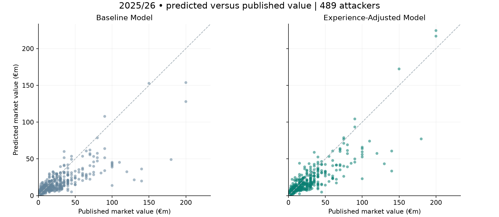

# WHAT IS HE WORTH?

**Estimating attacking players' market values with linear regression.**

An interactive football analytics project comparing a performance-based model with an experience-adjusted model across Europe's five major leagues. Search for a player, change their profile, and explore where the estimates succeed or miss.

## Explore the project

- **Streamlit app:** `app.py` — player search, hypothetical profiles, interactive charts and downloadable comparisons. Public deployment is pending; there is no live app URL yet.
- **Research notebook:** [Full analysis](Predicting%20the%20Market%20Value%20of%20Attacking%20Players%20Using%20Linear%20Regression.ipynb).
- **Results:** [Comparison chart](reports/accuracy.png), [model metrics](reports/metrics.csv) and [player comparisons](reports/player_comparisons.csv).



## Main result

On 489 eligible attackers in the 2025/26 development evaluation:

| Model | Mean absolute error | Median absolute error |
| --- | ---: | ---: |
| Baseline | €10.39m | €4.53m |
| Experience-adjusted | €8.70m | €3.96m |

Adding prior high-level experience reduces mean absolute error by **€1.70m (16.3%)**. Individual error improves for **57.7%** of players. A paired player bootstrap gives a 95% interval of €1.11m–€2.33m for the reduction in mean absolute error, conditional on these fitted models.

**This is a development evaluation, not an untouched final test.** The 2025/26 errors helped motivate the experience features, although that season never enters coefficient fitting. The target is a published Transfermarkt valuation, not a transfer fee or a guaranteed future sale price.

## Run locally

Use **Python 3.12**. From this project's root folder:

```bash
python -m venv .venv
```

Activate the environment:

```powershell
# Windows PowerShell
.\.venv\Scripts\Activate.ps1
```

```bash
# macOS / Linux
source .venv/bin/activate
```

Then install and launch:

```bash
python -m pip install -r requirements.txt
python -m streamlit run app.py
```

The prepared data is bundled. No API keys, database, or live downloads are needed to use the app. Models fit from the bundled snapshot and are cached on startup. Hypothetical inputs stay in the visitor's session; they do not change the dataset.

## Method

Both models use ordinary least squares on log market value, with predictions exponentiated back to euros.

- **Baseline:** age, age squared, log season minutes, goals per 90, assists per 90, league and attacking position.
- **Experience-adjusted:** the baseline plus log(1 + prior top-five-league minutes) and log(1 + prior Champions League minutes).
- **Training:** 1,331 player-seasons from 2022/23–2024/25.
- **Evaluation:** 489 players from 2025/26.
- **Eligibility:** attackers aged 18–36, at least 900 domestic league minutes, and a positive valuation no more than 90 days old at the cutoff.
- **Target timing:** latest recorded valuation available 19 days after the end of the performance season. Some valuations predate the season's final matches, so this is contemporaneous estimation rather than strict forward forecasting.

Experience includes only recorded minutes before the season starts. Previous market value is not a feature. Earlier-season checks, league breakdowns and freshness-coverage comparisons are included in the app and reports.

## Reproduce and test

```bash
python -m pip install -r requirements-dev.txt
python -m pytest -q
python run_analysis.py
```

Tests cover independent OLS agreement, training/evaluation separation, experience chronology, valuation boundaries, invalid inputs, and the app's scenario/reset/player-selection flow. GitHub Actions runs the test suite on Python 3.12.

Optional notebook and PDF tooling:

```bash
python -m pip install -r requirements-analysis.txt
python build_report.py
```

To rebuild the prepared snapshot from upstream source files:

```bash
python -m pip install -r requirements-analysis.txt
python preparation/download_data.py --destination raw_data
python preparation/prepare_data.py --raw raw_data
python preparation/add_experience.py --raw raw_data
python run_analysis.py
```

These commands overwrite prepared data and reports. Upstream files can change; the bundled CSV is the reproducible input for this release. Original source hashes and preparation notes are recorded in [source_notes.json](data/source_notes.json).

## Publish a browser-accessible app

GitHub stores the source; Streamlit Community Cloud runs the Python app. See [DEPLOYMENT.md](DEPLOYMENT.md) for the exact repository settings and deployment steps. After deployment, add the verified live URL at the top of this README and to the repository's About website field so visitors can launch it directly.

## Project structure

| Path | Purpose |
| --- | --- |
| `app.py` | Streamlit interface |
| `modelling.py` | Validation, model fitting and predictions |
| `evaluation.py` | Metrics, bootstrap and temporal checks |
| `charts.py`, `presentation.py` | Shared charts and display labels |
| `data/` | Prepared snapshot and provenance |
| `preparation/` | Download and preparation scripts |
| `run_analysis.py` | Rebuild comparison tables and figures |
| `reports/` | Exported results and summary report |
| `tests/` | Model and app regression tests |

## Limitations and attribution

Contract length, wages, injuries and other valuation drivers are absent. Recorded experience starts in 2012 and may not cover full careers. Position labels come from a profile snapshot. League-season coverage has gaps, particularly Ligue 1 in 2022/23 and Serie A in 2024/25; valuation freshness also affects inclusion. Exponentiating a log regression does not produce an unbiased conditional mean or directly optimise euro MAE. The bootstrap is not a player prediction interval and does not capture all shared league effects. An untouched future season remains the next evaluation.

Data comes from [dcaribou/transfermarkt-datasets](https://github.com/dcaribou/transfermarkt-datasets), based on Transfermarkt. The bundled provenance records the source repository's CC0-1.0 designation; this does not imply ownership of Transfermarkt branding or endorsement. This project is independent of Transfermarkt. No separate open-source licence has been assigned to this project's original code.
